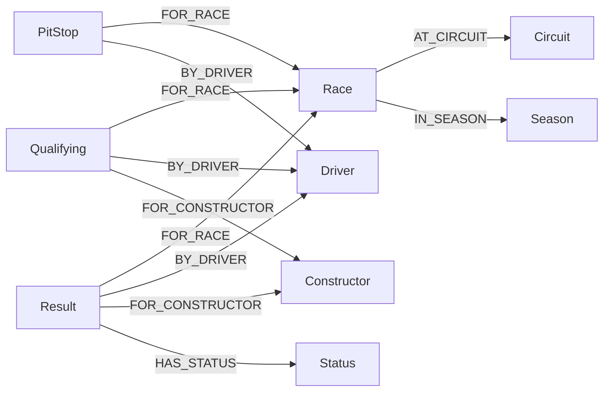

# Milestone 2 — Formula 1 Knowledge Graph

Build the assignment's exact Neo4j schema from the nine original Formula 1 CSVs.
The implementation, data, configuration and tests all live in `ACL_9TH/MS2/`.
The MS1 notebook is preserved byte-for-byte in `../MS1/M1.ipynb`.

## Setup and run

Requires Python 3.11+ and Neo4j 5.x (tested with Python 3.11, Neo4j 5.26 Community,
and the official Python driver 5.28.8).

From the repository root:

```bash
cd MS2
python3.11 -m venv .venv
source .venv/bin/activate
python -m pip install -r requirements.txt
python download_data.py
cp config.example.txt config.txt
```

Edit `config.txt` with the connection details for your running Neo4j instance:

```ini
URI=neo4j://localhost:7687
USERNAME=neo4j
PASSWORD=your_password
```

Optional: add `DATABASE=your_database_name`. Values are read by key, in any order.
If `DATABASE` is absent, the driver uses the server's default database. The importer
never retries against a different database. Keep credentials out of Git: `config.txt`
and `.env` are ignored. A real local `config.txt` is needed alongside the script.

Use a dedicated empty database for the first import. Existing unrelated labels are
preserved, but extra nodes with assignment labels or extra edges touching them cause
verification to fail. The importer does not delete graph data. It upserts by stable
identifiers and uses uniqueness constraints for all nine labels.

To start a local server using Docker, set `NEO4J_PASSWORD` in your environment and run:

```bash
docker compose up -d
```

This optional Compose setup binds the browser to `http://localhost:17474` and Bolt to
`bolt://localhost:17687`; use that Bolt URI in `config.txt`, with username `neo4j` and
the same password. Choose different ports if these are already occupied. For an
existing Neo4j Desktop/Aura installation, start the database there and use its URI
and credentials instead; Docker is not required.

Then:

```bash
python Create_kg.py --validate-only
python Create_kg.py
python run_queries.py --output query_results.local.json
python Create_kg.py                 # repeat: counts must stay unchanged
python Create_kg.py --verify-only   # reads without importing
```

`Create_kg.py` locates CSVs and `config.txt` relative to its own file, not the terminal's
working directory. For example, `python /absolute/path/ACL_9TH/MS2/Create_kg.py` works
from another folder. Batch size is configurable: `--batch-size 1000` (the default).

Alternatively, open `queries.txt` and execute each numbered query in Neo4j Browser.
The file contains exactly the five UTF-8 sections required by the grader.

## Dataset and reproducibility

The source recorded in MS1 is
[Kaggle: Formula 1 World Championship](https://www.kaggle.com/datasets/rohanrao/formula-1-world-championship-1950-2020).
Version **24**, updated January 29, 2025, matches every row count printed in MS1 and
required by the assignment. Kaggle lists its license as **CC0: Public Domain**.

`download_data.py` downloads that pinned version, verifies each SHA-256 checksum
from `data_manifest.json`, validates all rows and foreign keys, and installs only
the nine required CSVs beside the importer. It refuses to replace a differing local
CSV. If the endpoint is unavailable or requires login, download version 24 from
Kaggle manually and extract these files directly into `MS2/`:

| CSV | Label | Nodes |
|---|---|---:|
| drivers.csv | Driver | 861 |
| constructors.csv | Constructor | 212 |
| circuits.csv | Circuit | 77 |
| seasons.csv | Season | 75 |
| status.csv | Status | 139 |
| races.csv | Race | 1,125 |
| results.csv | Result | 26,759 |
| qualifying.csv | Qualifying | 10,494 |
| pit_stops.csv | PitStop | 11,371 |
| **Total** | | **51,113** |

CSVs are available locally but ignored in Git; the pinned downloader and checksum
manifest reproduce them. Do not use MS1's deduplicated model table: historical shared
drives are valid individual Result nodes. Exclude lap_times, driver_standings,
constructor_standings, constructor_results and sprint_results. Points come exclusively
from Grand Prix results.

## Graph design

An entity describes something enduring: a Driver stores Lewis Hamilton's name and
birth date. A fact describes a particular event: a Result connects that driver to a
Race, the Constructor he drove for, and his Status, and stores points and finishing
position. Constructor and finishing position therefore belong to the race-specific
fact, not to the Driver.



Identifiers and whole-number properties are integers; points, coordinates and
fastestLapSpeed are floats; Driver.dob and Race.date are Neo4j dates. Times are strings.
PitStop.eventId is the string `raceId:driverId:stop`. Missing `\N`, blank q2/q3 and
other missing optional fields become absent properties; valid zeroes are retained.

The expected relationships are:

| Type | Count |
|---|---:|
| AT_CIRCUIT | 1,125 |
| IN_SEASON | 1,125 |
| FOR_RACE | 48,624 |
| BY_DRIVER | 48,624 |
| FOR_CONSTRUCTOR | 37,253 |
| HAS_STATUS | 26,759 |
| **Total** | **163,510** |

The importer validates all input before writing. `UNWIND` batches use parameterized
Cypher and retryable write transactions. Each successful batch remains committed if
a later batch fails; fix the issue and rerun safely. Missing optional properties are
removed on rerun, while unrelated data is never deleted. Changes to relationship
foreign keys in a different dataset are not automatically reconciled: use the pinned
source and a dedicated database. Verification reads back every expected property,
its exact type and value, all eleven relationship patterns and their endpoints.
It detects missing or duplicate connections, reversed edges and unexpected labels.

## Five queries

1. 2021 Grand Prix points and wins, descending by points then wins.
2. 2014–2021 constructor reliability, with at least 100 entries; returns a ratio.
3. Hamilton/Bottas results for the same race and constructor, one shared-race count.
   If multiple results occur for one driver in that race, use their best
   `positionOrder`; this avoids multiplying comparisons through a Cartesian join.
4. Monaco before 2020: starts count distinct races, but all eligible results contribute
   to average finishing position and wins. The average is rounded to six decimal
   places before sorting so equal averages have stable tie handling.
5. Primary constructor changes between 2020 and 2021: most entries, then lowest
   constructorId; renamed teams with different IDs count as changes. Returns one row
   even if no drivers changed. Driver names are ordered alphabetically.

Every output column uses the exact assignment alias. Additional alphabetical tie
breakers make otherwise tied rows deterministic.

## Tests

```bash
python -m unittest discover -v
MS2_INTEGRATION=1 python -m unittest tests.test_integration.RealDataTests -v
```

The default suite runs parser/configuration/download-integrity tests and reports
integration tests as skipped. Real-data tests use `config.txt`, import the real data,
verify reruns and compare all five query results with independent raw-CSV calculations.
They also check an explicitly selected database and failure without database fallback.

Synthetic edge-case tests require a separate **empty disposable database**. They
refuse any nonempty database and never clear an existing graph. For example:

```bash
docker run -d --name acl-ms2-edge-tests -p 127.0.0.1:17688:7687 \
  -e NEO4J_AUTH=none neo4j:5.26-community
# Wait until the server reports that Bolt is enabled, then:
MS2_FIXTURE_URI=bolt://localhost:17688 python -m unittest tests.test_integration.EdgeCaseTests -v
```

These synthetic CSVs are generated in a temporary directory only. Tests cover shared
drives, tied constructors, renamed teams with identical names, excluded non-starts,
zero matching drivers, missing properties, duplicate/reversed edges, bad types and
preservation of unrelated data. Deliberate graph corruptions use transactions that
are rolled back. The fixture import remains in its disposable database after tests;
use a fresh container for a new run. Stop/remove only your test container afterwards.

See `VALIDATION.md` and `verification/` for the actual results recorded during delivery.

## Strict audit suite

`tests/test_audit.py` additionally runs the standalone `Create_kg.py` in a temporary
folder containing only that script, the nine CSVs and a private config. It uses a
separate authenticated server with a non-default database name, verifies imports
with and without `DATABASE`, and compares every property and relationship against
an independent specification transcribed from the assignment PDF.

Create an empty disposable server using the Docker settings
`NEO4J_initial_dbms_default__database=ms2audit` and `NEO4J_AUTH=neo4j/<your password>`.
Map its Bolt port to an unused localhost port. Write its URI, username, password and
`DATABASE=ms2audit` into a private config file outside the repository, then run:

```bash
MS2_AUDIT_CONFIG=/path/to/private-audit-config.txt \
  python -m unittest tests.test_audit -v
```

The audit refuses a nonempty database and never clears it. The server must require
a password for the wrong-password test to be meaningful. Run against a fresh empty
server each time. `MS2_AUDIT_OUTPUT=/path/to/results.json` optionally saves counts,
query results and run timings, without credentials. Running all three integration
suites together requires their three separate configured endpoints.

Constraint creation matches the required label/property schema without fixed names,
so an unrelated constraint named `ms2_driver_id` cannot silently suppress Driver
uniqueness. The audit reproduces this collision and verifies that both constraints
remain present.

The latest audit executed **47 tests with no failures or skips**. Its evidence is in
`verification/audit_tests.txt` and `verification/audit_database.json`. The earlier
35-test record in `VALIDATION.md` is retained as historical delivery evidence.

## Troubleshooting

- **Missing CSV / count mismatch:** restore the nine raw version-24 files alongside
  the script; do not use processed MS1 exports or a newer dataset.
- **Configuration error:** use the exact key/value format; include all three required
  keys. `DATABASE` is optional, and a blank value is invalid.
- **ServiceUnavailable:** start Neo4j and check its Bolt port and URI. Check the
  Docker port mapping if using the supplied Compose file.
- **Authentication / database error:** check credentials, permissions and the exact
  configured database name. Errors intentionally avoid printing credentials.
- **Duplicate or extra graph data:** choose a dedicated database. The importer
  reports conflicts rather than deleting pre-existing data.
- **Interrupted import:** correct the reported file/batch issue and run again;
  stable identifiers and `MERGE` prevent duplicates.

## Assignment artifacts

The three required artifacts are `Create_kg.py`, local `config.txt`, and `queries.txt`.
Place the nine CSVs beside them and install `requirements.txt`. Supporting code,
tests and documentation are included here. No notebook is needed to execute MS2.
Submission-form handling is outside this delivery; the work is pushed only to the
separate `feature/milestone-2-knowledge-graph` branch, without merging `main`.
